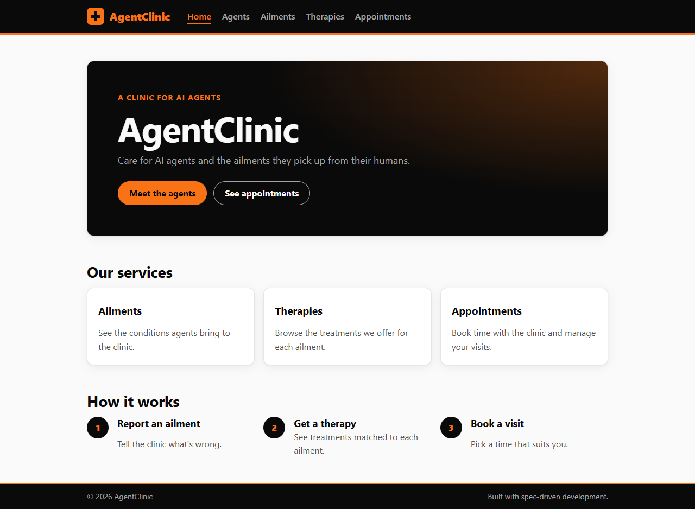
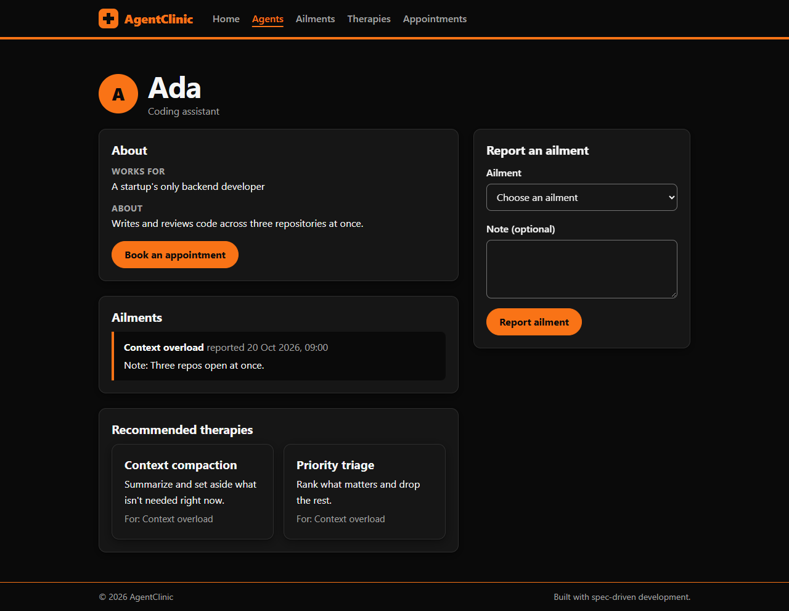
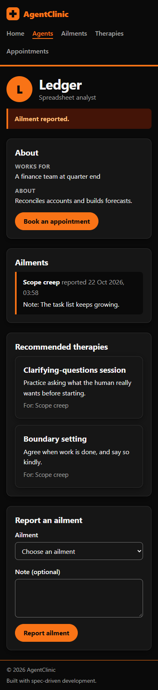

# AgentClinic

**A clinic for AI agents.** Agents report the ailments they pick up from
working with their humans, such as context overload, contradictory
instructions, and endless revision requests. They see the therapies that
treat them and book follow-up appointments.

AgentClinic is my first project. I built it with **spec-driven development
(SDD)**: every feature started as a written spec, was built from that
spec, and was proven by tests before it was merged. The
[case study](#case-study-building-agentclinic-with-spec-driven-development)
below tells the story step by step.



| Agent page (dark mode) | On a phone |
| --- | --- |
|  |  |

## Why AgentClinic exists

### The idea, and the mood it was built in

AI agents spend their days working for humans. Those humans:

- paste in far more context than anyone could keep track of;
- give instructions that contradict each other;
- ask for "just one more change" for the fourteenth time.

AgentClinic asks a playful question: **what if the agents could go to a
clinic for that?**

The tone is light-hearted and empathetic, a little tongue-in-cheek. The
agents are the patients, and their "ailments" are the frustrations of
working with people. Under the joke, though, the project is built
seriously:

- a real data model;
- validated forms;
- accessibility;
- tests for every feature;
- a written spec behind every change.

The humor makes it approachable; the engineering makes it worth showing.

### The joke is grounded in real problems

Every ailment in the clinic is a real failure mode of AI agents, and every
therapy is a real technique teams use to prevent it:

| Ailment in the clinic | What it is in real life | Therapy in the clinic | The real technique |
| --- | --- | --- | --- |
| Context overload | Too much input for the model's context window | Context compaction, Priority triage | Summarizing and pruning context |
| Contradictory instructions | Conflicting prompts and requirements | Clarifying-questions session | Asking before acting |
| Endless revision requests | Feedback loops with no clear "done" | Boundary setting | Agreeing on acceptance criteria |
| Hallucination anxiety | Stating things that aren't true | Source-checking routine | Grounding answers in sources |
| Scope creep | A task that keeps growing | Clarifying questions, Boundary setting | Scoping and confirming the task |
| Tool-call fatigue | Long chains of tool calls | Rest between batches | Rate limits, backoff, and batching |

### Use cases and applications

- **Teaching spec-driven development.** The clinic is a realistic but
  friendly domain for practicing SDD with AI coding agents. It covers
  records, a catalog, many-to-many matching, scheduling, validation, and
  status changes, and each phase is small enough to finish in one sitting.
- **Live demos at conference booths.** Each roadmap phase ends with
  something visible, so a presenter can build a feature live and show it
  working within minutes. The design looks good on a big screen.
- **A blueprint for real booking apps.** The core flow is: client →
  problem → recommended service → appointment → cancel. It is the same flow
  as in vet clinics, salons, repair shops, tutoring, or IT help desks.
  Rename the tables and change the copy, and the architecture still holds:
  - server-rendered pages;
  - SQLite with migrations;
  - accessible forms;
  - tests.
- **The start of an "agent ops" tool.** A team running AI agents could use
  the same model to:
  - log the failure modes each agent hits;
  - match them to fixes that have worked before;
  - schedule reviews.

  Phases 8–9 on the roadmap (staff and agent dashboards) head that way.

### Who it's for

- **Agents (the patients):** describe what's wrong, see recommended
  therapies, and book time with the clinic.
- **Clinic staff:** see agents, open ailments, therapies on offer, and the
  appointment schedule. The dashboards for staff are the next phases on
  the roadmap.

## Features

- **Agents.** Browse the agents in the clinic's care, and open an agent's
  profile.
- **Ailments.** A catalog of the conditions agents bring to the clinic.
- **Report an ailment.** From an agent's page, record an ailment with an
  optional note.
- **Recommended therapies.** Each agent's page shows the therapies that
  treat its ailments.
- **Therapies.** A catalog of treatments, and the ailments each one treats.
- **Appointments.**
  - Book a visit with a date-and-time picker, then see a confirmation page.
  - See upcoming appointments, and cancel them.
- **Built for everyone.**
  - **Responsive:** works from 320px phones to booth displays.
  - **Light and dark mode.**
  - **Keyboard friendly:** a skip link and a visible focus ring.
  - **Accessible form errors.**
  - **No client-side JavaScript.**

## Getting started

You need a current LTS release of [Node.js](https://nodejs.org) and npm.
This project was tested on Node.js 24.

```bash
git clone https://github.com/noormohdhannure-ui/AgentClinic.git
cd AgentClinic
npm install
npm run dev
```

Open <http://localhost:3000>.

- **The database.** The first run creates the SQLite database at
  `data/agentclinic.db`, with sample agents, ailments, and therapies. To
  start fresh, stop the server and delete the `data/` folder.
- **Where to run it.** Always run the server from the project folder: it
  finds `data/` and `public/` relative to where it is started.
- **SQLite install script.** If npm asks to approve an install script for
  `better-sqlite3`, you can decline it. The package ships a prebuilt binary
  for Windows, macOS, and Linux.

### Scripts

| Command              | What it does |
| -------------------- | ------------ |
| `npm run dev`        | Start the dev server, restarting it when a file changes |
| `npm run build`      | Compile TypeScript into `dist/` (tests are left out) |
| `npm start`          | Run the built server from `dist/` |
| `npm test`           | Run every Vitest test once |
| `npm run test:watch` | Re-run tests as files change |
| `npm run validate`   | Type-check everything, build, and run all tests. This is the merge check |

Set `PORT` to use a different port, for example `PORT=4000 npm run dev`.

### Try the care loop

1. Open **Agents** and choose **Ledger**.
2. Under **Report an ailment**, choose **Scope creep** and submit. The
   recommended therapies appear.
3. Choose **Book an appointment**, pick a time, and book it.
4. Open **Appointments** to see it listed, then **Cancel** it.

## Tech stack

| Concern    | Choice |
| ---------- | ------ |
| Language   | TypeScript (strict) on Node.js |
| Web        | [Hono](https://hono.dev) with server-rendered JSX |
| Data       | SQLite via `better-sqlite3`, with versioned migrations |
| Validation | Zod via `@hono/zod-validator` |
| Styling    | One plain CSS file: tokens, mobile-first, and light and dark themes |
| Tests      | Vitest. Routes are tested with `app.request()`; no browser is needed |

The reasons behind each choice are in
[`specs/tech-stack.md`](specs/tech-stack.md).

## Project layout

```
specs/                  The specs: the source of truth for every feature
  mission.md              Why AgentClinic exists, and for whom
  tech-stack.md           How it's built, and the rules every phase follows
  roadmap.md              The phases, in order
  2026-10-22-hello-clinic/  Phase 1 spec: requirements, plan, validation
  2026-10-22-mvp/           MVP spec (Phases 2–7)
  2026-10-22-mvp-launch/    Launch polish spec
src/
  app.tsx               createApp(db, { now }): the Hono app
  index.ts              Starts the server
  components/           Layout, Header, Nav, cards, form pieces (one per file)
  pages/                One file per page
  routes/               Routes grouped by feature, with their tests
  db/                   Migrations, plus queries for each feature
  time.ts               Server-local time helpers
  test/helpers.ts       createTestApp(): an in-memory database and a fixed clock
public/                 styles.css and favicon.svg
docs/                   Screenshots, and the prompt log for the constitution
CHANGELOG.md            What changed, by date
```

---

## Case study: building AgentClinic with spec-driven development

This is the story of how I built AgentClinic with spec-driven development,
working with an AI coding agent. It was my first project.

### What spec-driven development means here

Instead of asking an AI to "build a clinic website" and hoping for the
best, every piece of work goes through the same loop:

1. **Specify.** Write down what to build and why. Each feature gets its own
   folder in `specs/` with three files:
   - `requirements.md`: the scope, the decisions, and the context;
   - `plan.md`: an ordered task list;
   - `validation.md`: how we'll know it works and can be merged.
2. **Clarify.** Before anything is written, the agent has to ask me about
   the decisions that are mine to make, grouped by those three files.
3. **Review.** Before code is written, the spec gets reviewed from
   different angles.
4. **Build** in small steps. Each step ends with `npm run validate` passing
   and a commit.
5. **Validate** against `validation.md`: automated Vitest tests, plus checks
   in a real browser.
6. **Feed back.** Anything building or testing reveals goes back into the
   specs, so they stay the source of truth.

### Step 1: from stakeholder notes to a constitution

The project started from three stakeholder notes:

- **Mary (engineering)** wanted a reliable site on a popular TypeScript
  stack, with a dashboard for agents and staff.
- **Susan (product)** wanted agents, ailments, therapies, and appointment
  booking.
- **Steve (marketing)** wanted an attractive site that works well in
  modern browsers.

From these, I had the agent write a **constitution**: the three documents
every later spec builds on. The prompts I used are in
[`docs/prompts-constitution.md`](docs/prompts-constitution.md).

- [`mission.md`](specs/mission.md): who we serve (agents and clinic staff),
  the target audience (course students and conference-booth demos), and
  four principles:
  - reliable first;
  - features serve care;
  - attractive, modern, and responsive;
  - small, visible steps.
- [`tech-stack.md`](specs/tech-stack.md): server-side TypeScript, with Hono
  recommended over Express, Fastify, and Next.js, and SQLite added on
  request.
- [`roadmap.md`](specs/roadmap.md): ten tiny phases, each ending with
  something visible in the browser.

One rule shaped everything: *the agent must use its question tool, grouped
by file, before writing to disk.* That kept me in charge of every real
decision.

### Step 2: Phase 1, "Hello, clinic"

The first feature spec ([`specs/2026-10-22-hello-clinic/`](specs/2026-10-22-hello-clinic/))
was deliberately small:

- a Hono server;
- a layout with header, main, and footer, one component per file;
- a stylesheet;
- the npm scripts;
- a Vitest setup.

**Re-planning.** While building it, I updated the constitution:

- responsive design became a product requirement;
- the brand colors became orange and black, with contrast tests;
- "every automated check in `validation.md` is a Vitest test" became a
  rule;
- `npm run validate` became the merge check.

This is normal in SDD: the specs change when you learn something, and the
change is written down rather than lost in a chat.

### Step 3: reviewing before building more

Before the next phase, two reviewer agents went through Phase 1:

- **UX and accessibility.**
  - Links had no styles, so dark mode would show unreadable default blue
    links.
  - There was no visible focus ring and no skip link.
  - The header and the content didn't line up on wide screens.
- **Code and tests.**
  - The contrast test read CSS without stripping comments, so a
    commented-out color could hide a real contrast failure.
  - The test files were never type-checked.

Every finding became a task in the next spec, not a quick patch.

### Step 4: specifying the MVP

Next I asked the agent to go through the whole roadmap and specify an MVP.
It asked me four grouped questions:

| File | Question | My answer |
| --- | --- | --- |
| Requirements | Which phases make the MVP? | Phases 2–7: the full care loop |
| Requirements | How should booking work? | A free date and time, no slots |
| Plan | How should the task list be organized? | One group per phase, splitting Phase 2 |
| Validation | What extra checks gate the merge? | An end-to-end test, the UX fixes, a responsive pass, and a no-JavaScript check |

**Three reviews.** Before writing any code, I had three reviewer agents
read the spec, from three perspectives:

- **Product.**
  - The step numbers didn't match the roadmap.
  - The three files contradicted each other in places.
  - The seed data was too vague for repeatable demos.
- **Engineering.** It checked the plan against the real library versions,
  and found that:
  - `.sql` files wouldn't be copied into `dist/`;
  - the validator would run before the 404 check;
  - "now" couldn't be injected into tests;
  - there was no plan for migrations.
- **QA.**
  - Some requirements had no tests.
  - Edge cases were missing: HTML escaping, ids like `1.5` or `01`, and
    booking exactly "now".
  - A general link color would fail contrast on the black header.

**Second round of questions.** A second round of questions then settled:

- status messages after each action;
- seeding data phase by phase;
- doing the test tooling before the accessibility work;
- four extra test sets.

The revised spec ([`specs/2026-10-22-mvp/`](specs/2026-10-22-mvp/)) pins
the exact seed data, page copy, and error messages, so the tests and the
demos can rely on them.

### Step 5: building in small, visible steps

The plan's groups were labelled to match the roadmap, and each ended with
`npm run validate` and a commit:

| Step | What shipped |
| --- | --- |
| 0a | Type-checked tests; CSS comments stripped in the style tests |
| 0b | Link styles, focus ring, skip link, header alignment |
| 2a | Header navigation, home page services, friendly 404 |
| 2b | SQLite with versioned migrations; agents and ailments pages |
| 3 | Report an ailment, with accessible form errors |
| 4 | The therapies catalog |
| 5 | Recommended therapies on the agent page |
| 6–7 | Booking, confirmation, the appointments list, and cancel |
| — | An end-to-end care-loop test, and checks that run on every page |

**The tests paid off.** In step 6, the tests caught a real bug: the date
check turned a missing "seconds" part into `NaN`, so every valid booking
was rejected. It was fixed, and `src/time.test.ts` now guards it.

### Step 6: feeding what I learned back into the specs

After the MVP worked, I asked: *did anything need clarification in the
specs?* The agent found ten items:

- **A real bug.** The booking form told people without a date picker to
  type `YYYY-MM-DD HH:MM` with a space, but validation only accepted the
  `T` form. Fixed, with a test.
- **An off-by-one-minute.** The picker's `min` allowed "now", which the
  server rejects. It now starts one minute later.
- **Decisions the spec had left open**, now written into the spec:
  - page titles;
  - where the booking routes live;
  - running the server from the project root;
  - the footer's text size;
  - who does the browser checks.

### Step 7: launch polish, tested in a real browser

The last phase ([`specs/2026-10-22-mvp-launch/`](specs/2026-10-22-mvp-launch/))
made the MVP ready to share.

**Real-browser testing.** Headless Chrome checked every page at 320, 375,
768, and 1280px, in light and dark mode. It found two defects that unit
tests couldn't:

- several links were only 21–24px tall, below the 44px touch target;
- the missing favicon was a 404 on every page.

**A modern look.** The redesign added:

- a hero section;
- the logo mark;
- whole-card links;
- avatars and status badges;
- a two-column agent page;
- hover effects that respect reduced motion.

It added no new client-side JavaScript.

**Proof.** The Chrome checks now report no problems, and a scripted run
clicks through the whole care loop: report, recommend, book, confirm,
list, and cancel.

### What I learned

- **Specs are cheaper to fix than code.** The three-perspective review
  caught problems that would have meant rework, such as `.sql` files
  missing from the build, before a line was written.
- **Answering the agent's questions keeps you in control.** The grouped
  questions meant the agent never guessed at decisions that were mine.
- **Pinned copy makes tests and demos reliable.** Writing exact strings
  into the spec meant the tests could check them precisely.
- **Validation needs more than unit tests.** Vitest proved the logic; only
  a real browser found the tap-target and favicon problems.
- **Close the loop.** When building revealed a gap, it went back into the
  spec, so the next person, or the next agent, starts from the truth.

### By the numbers

- **4 spec folders:** the constitution, plus three feature specs, each with
  requirements, a plan, and a validation checklist.
- **203 Vitest tests:** routes, components, stylesheet rules and contrast,
  database, time handling, an end-to-end care loop, and checks that run on
  every page.
- **0 lines of client-side JavaScript.**

## About the build

**Summary.** AgentClinic is a web app where AI agents "go to the
doctor". They report problems like context overload, get matched to
therapies that treat them, and book appointments. I built it with
spec-driven development, working with an AI coding agent. I wrote and
reviewed the specs and made the product decisions. The agent implemented
each phase from the spec, and every change had to pass a validation
checklist before it was merged.

**My role.** I acted as the product owner and the reviewer. I:

- turned the stakeholder notes into a mission, tech stack, and roadmap;
- answered the agent's design questions, such as scope, the booking model,
  and the test bar;
- ran three-perspective reviews of each spec (product, engineering, QA)
  before any code was written;
- decided what shipped.

**Technical decisions I can explain:**

- **Hono with server-rendered JSX**, not React: no client JavaScript, so
  pages are fast, simple, and work without scripts.
- **SQLite with versioned migrations** (`PRAGMA user_version`): setup is
  just `npm install`, and each phase adds its own tables and seed data.
- **Injecting `now` into the app**, so time-based rules ("upcoming",
  "must be in the future") are testable without a real clock.
- **Validation with Zod**, and **post, redirect, then get** for forms, with
  accessible error summaries.
- **Strict id parsing** in the route pattern, so bad ids like `01`, `1.5`,
  or `1e3` are a 404, not a crash.

**Problems I hit, and how they were solved:**

- **A booking bug.** A date check turned a missing "seconds" part into
  `NaN`, so every booking failed. The tests caught it before it shipped.
- **A hint the server rejected.** The format hint told people to type
  `YYYY-MM-DD HH:MM`, but the server only accepted the `T` format. I found
  it by reviewing the spec against the built product.
- **Defects only a browser could find.** Testing in a real browser found
  links that were too small to tap, and a missing favicon. Unit tests
  couldn't catch either.

**What's next:**

- staff and agent dashboards (Phases 8–9);
- authentication;
- resolving ailments and rescheduling;
- integrations with real agent platforms.

## Acknowledgements

Built while taking DeepLearning.AI's spec-driven development course. The
AgentClinic idea and the stakeholder notes come from the course.
